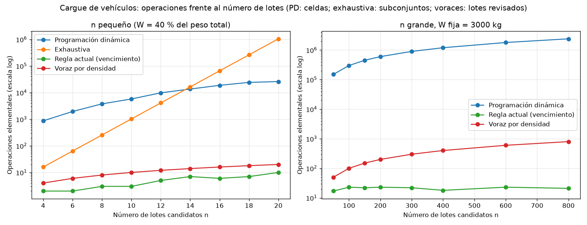

# Análisis de algoritmos — Proyecto final — Grupo 12

**Caso asignado:** Caso de estudio 3 — Planeación diaria de despachos de un banco de alimentos.

**Integrantes:**

- Mateo Orozco Oquendo
- Cristian Jose Mendez
- Jhon Alejandro Isaza Pérez
- Samuel Arango Montoya

**Estado:** entrega final del proyecto (23 de noviembre de 2026). Operaciones trabajadas: 3, cargue de los vehículos (mochila 0/1 por programación dinámica), y 4, saturación de la bodega (dividir y vencer y programación dinámica con Kadane). El informe en PDF, con el mismo contenido de este README, está en [`informe_final.pdf`](informe_final.pdf).

---

## 1. Análisis del problema

### 1.1 Descripción del problema computacional

El Banco Regional de Alimentos recibe donaciones de supermercados, industria y productores del campo (muchas próximas a vencer) y las reparte a 420 organizaciones: comedores comunitarios, hogares de adultos mayores, jardines infantiles y fundaciones. Cada madrugada un proceso planea los despachos del día: qué lotes salen, en qué orden y en qué vehículo. La operación creció más del doble en tres años y la planeación, que debe caber entre las 03:00 y las 05:00, hoy tarda cerca de 4 horas y media. Por eso los vehículos salen tarde, las organizaciones reciben después de preparar sus comidas y parte de los perecederos se vence en la bodega.

El proceso tiene cuatro operaciones, y cada una es un problema computacional distinto:

| # | Operación | Entrada | Salida | Restricción principal |
|---|---|---|---|---|
| 1 | Consulta de inventario | ≈ 220.000 lotes activos; ≈ 30.000 consultas por código al día y consultas por rango de vencimiento | el lote con ese código, o los lotes que vencen en el rango | una consulta por código responde en menos de 1 s |
| 2 | Ordenamiento FEFO | la lista del día anterior, ya ordenada, más 6.000 a 9.000 lotes nuevos al final | los lotes ordenados por vencimiento y, a igual fecha, por categoría | ningún lote vencido sale; dentro de una categoría sale primero el que vence primero |
| 3 | Cargue de los vehículos | 300 a 600 lotes candidatos por ruta (peso, valor); 14 vehículos de 2.500 a 4.000 kg | los lotes que suben a cada vehículo | no superar la capacidad; valor nutricional máximo, no una aproximación |
| 4 | Análisis de saturación | por cada una de las 40 categorías, el cambio neto del inventario hora por hora (≈ 36.000 horas) | el tramo de horas consecutivas de mayor crecimiento | el tramo es el de mayor crecimiento, no una aproximación |

Las operaciones 1 a 3 corren cada madrugada dentro de la ventana de 2 horas, en un computador de escritorio de 150 W y sin procesamiento en paralelo. La operación 4 es un análisis que la Dirección necesita para dimensionar el cuarto frío que piensa alquilar en temporada. En todas, el registro original de cada lote no se puede modificar, por la trazabilidad sanitaria.

Trabajamos dos operaciones. La **3 (cargue de los vehículos)** admite programación dinámica y fue el Laboratorio 4. La **4 (saturación de la bodega)** es la de mayor costo computacional de todo el proceso (sección 1.3) y admite dividir y vencer y programación dinámica. Las operaciones 1 y 2 quedan analizadas en la sección 1.3 y como recomendación para una siguiente fase.

### 1.2 Operación 3 — Cargue de los vehículos: entradas, salida y restricciones

Hoy en día, para cada ruta, el coordinador toma los lotes candidatos, los ordena por fecha de vencimiento y los va metiendo al vehículo uno por uno. Cuando llega a un lote que ya no cabe, se detiene y no sigue mirando. Ese procedimiento tiene dos fallas claras: primero, no tiene en cuenta el valor nutricional de los lotes, solo la fecha; segundo, se detiene en el primer lote que no cabe aunque más adelante haya lotes más livianos que sí entrarían. Es como empacar una maleta por orden de fecha y parar en la primera prenda que no cabe, aunque las medias sí cabrían. Según el banco, los vehículos salen en promedio al 78 % de su capacidad, y esta regla explica buena parte de ese espacio perdido. Nuestro objetivo en esta operación es decidir qué lotes subir a cada vehículo para llevar la mayor cantidad de valor nutricional posible sin pasarnos de la capacidad en kilos.

| Elemento | Detalle | Unidades / límites del caso |
|---|---|---|
| Entrada 1 | Lista de lotes candidatos de una ruta; cada lote = (peso, valor nutricional, días para vencer) | peso entero en kg; 300 a 600 lotes por ruta |
| Entrada 2 | Capacidad máxima del vehículo `W` | entero en kg; entre 2.500 y 4.000 kg; 14 vehículos |
| Salida | Valor nutricional máximo cargado y los índices de los lotes que suben | raciones ponderadas por prioridad (proteína, frutas y verduras, otros) |
| Restricción 1 | La suma de pesos de los lotes cargados ≤ `W` | ningún vehículo supera su capacidad |
| Restricción 2 | Un lote sube completo o no sube (0/1) | no se fracciona |
| Restricción 3 | El valor es el **máximo**, no una aproximación | exactitud |
| Restricción 4 | Termina dentro de la ventana de planeación compartida por las operaciones 1 a 3 | 2 h (03:00–05:00), PC de 150 W |
| Restricción 5 | El registro original de cada lote no se modifica | trazabilidad sanitaria |

En vez de devolver lotes nuevos o modificados, lo que entregamos son las posiciones (índices) de los lotes que van en el vehículo. Esto es importante porque la lista original queda tal cual y, si hay que hacer un retiro de producto, cada lote se puede rastrear con el registro con el que llegó a la bodega. Es una restricción de trazabilidad sanitaria que exige el caso.

### 1.3 Operaciones críticas del proceso y costo energético actual (línea base)

| # | Estrategia actual | Costo | Tamaño real | Trabajo aproximado |
|---|---|---|---|---|
| 1 | El inventario es una lista y cada consulta la recorre completa | Θ(n) por consulta; Θ(q·n) al día | n ≈ 220.000 lotes; q ≈ 30.000 consultas | hasta ≈ 6.600 millones de comparaciones por noche |
| 2 | Ordenamiento por inserción sobre la lista de ayer con los nuevos al final | Θ(n·k) en el peor caso: cada lote nuevo puede recorrer toda la lista | n ≈ 220.000; k ≈ 9.000 nuevos | hasta ≈ 2.000 millones de comparaciones por noche |
| 3 | El coordinador carga por vencimiento hasta que no cabe el siguiente lote | Θ(n log n) | 14 rutas de 300 a 600 lotes | milisegundos; el problema es la calidad: lleva ≈ 42 % del valor óptimo (5.1) |
| 4 | Evalúa todos los tramos posibles, sumando cada uno desde cero | Θ(n³) | 40 categorías × 36.000 horas | ≈ 7,8 billones de sumas por categoría; más de un día de cómputo según el banco |

De las cuatro, **la operación 4 es la más costosa**: el banco reporta que tarda más de un día para las 40 categorías, y nuestra fuerza bruta cúbica, medida y extrapolada, tardaría meses en Python (sección 4.4). Dentro de la ventana nocturna, las más costosas son la **1 y la 2**: juntas suman miles de millones de comparaciones cada madrugada. La regla actual de la **3**, en cambio, tarda milisegundos; su problema no es el tiempo sino que no carga el máximo valor.

Los conteos de las operaciones 1 y 2 son estimaciones a partir de la complejidad y de los volúmenes del caso, no mediciones nuestras, porque esas dos operaciones no las implementamos.

**Línea base energética del proceso actual** (kWh = kW × h, con 0,15 kW):

| Proceso actual | Tiempo | Energía por vez | Veces al año | Energía al año |
|---|---|---|---|---|
| Planeación de la madrugada (operaciones 1 a 3) | ≈ 4,5 h (dato del banco) | 4,5 h × 0,15 kW ≈ 0,675 kWh | 300 días de operación | ≈ 202,5 kWh |
| Análisis de saturación (operación 4) | más de 24 h (dato del banco) | más de 3,6 kWh | 1 vez al año (supuesto nuestro) | más de 3,6 kWh |
| **Total** | | | | **más de 206 kWh al año** |

Esta es la línea base contra la que comparamos las propuestas en la sección 6.1. Suponemos que el análisis de saturación se corre una vez al año, porque sirve para decidir el alquiler del cuarto frío de cada temporada.

### 1.4 Supuestos

- Partimos de que los lotes candidatos de cada ruta ya vienen sin vencidos: todos tienen al menos un día para vencer. La tarea de sacar los vencidos le corresponde al ordenamiento FEFO de la operación 2, no a esta.
- El valor nutricional de un lote lo manejamos como un entero: las raciones que aporta multiplicadas por la prioridad de su categoría (proteína 3, frutas y verduras 2, otros 1). El caso dice "raciones ponderadas por prioridad" pero no dice cuánto vale cada prioridad, entonces esos números los definimos nosotros.
- Cada vehículo lo resolvemos por separado: los lotes candidatos de una ruta no compiten con los de otra.
- No trabajamos con el volumen real. Generamos datos sintéticos con [`datos.py`](src/cargue_vehiculos/datos.py) (pesos enteros de 5 a 300 kg, semilla fija 2026), medimos con tamaños que van creciendo y extrapolamos al volumen del banco.
- Solo consideramos el peso. No modelamos el volumen de las cajas ni si un lote requiere refrigeración. Por eso con nuestros datos la regla actual llena cerca del 97 % del vehículo y no el 78 % que reporta el banco. La diferencia tiene una explicación: la regla actual se detiene cuando el siguiente lote no cabe, así que el espacio que queda vacío siempre es menor que el peso de ese lote. En nuestros datos ningún lote pesa más de 300 kg y los vehículos cargan al menos 2.500 kg, entonces lo desperdiciado es como máximo 300 / 2.500 = 12 % y el llenado nunca baja de alrededor del 88 %. Que el banco reporte 78 % indica que en la realidad hay lotes mucho más pesados (por ejemplo estibas o bultos grandes) o restricciones que no simulamos, como el volumen o la refrigeración. Lo que sí se mantiene es que esa regla lleva mucho menos valor nutricional que el óptimo: con nuestros datos, el 42,3 % (sección 5.1).

## 2. Diseño de la solución

### 2.1 Estructuras de datos seleccionadas

| Dato | Estructura | Por qué |
|---|---|---|
| Lotes candidatos de una ruta (op. 3) | lista de tuplas `(peso_kg, valor, días_para_vencer)` | acceso por índice en O(1); la programación dinámica recorre los lotes en orden; las tuplas no se pueden modificar, lo que protege el registro original |
| Tabla de la programación dinámica (op. 3) | lista de listas de (n + 1) × (W + 1) enteros | cada celda se lee en O(1); se guarda completa porque la reconstrucción de los lotes elegidos necesita todas las filas |
| Resultado del cargue (op. 3) | `(valor, lista de índices)` | devolvemos posiciones, no copias ni lotes modificados (trazabilidad) |
| Serie de una categoría (op. 4) | lista de enteros, kg por hora | se recorre en orden y el acceso por índice O(1) permite dividirla en mitades sin copiarla |
| Estado de Kadane (op. 4) | tres variables: `mejor_aqui`, `inicio_aqui` y `mejor` | memoria Θ(1): cada paso solo necesita el valor de la hora anterior |
| Recursión de dividir y vencer (op. 4) | pila de llamadas de profundidad ⌈log₂ n⌉ | unos 16 niveles para 36.000 horas; trabaja con índices sobre la misma lista, sin copiar mitades |
| Resultado del tramo (op. 4) | tupla `(crecimiento, inicio, fin)` | identifica el tramo sin modificar la serie |

Para las operaciones que no implementamos, la sección 1.3 muestra que la estructura es justamente el problema. Recomendamos, para una siguiente fase:

- **Operación 1:** un diccionario (tabla hash) de código → lote, para que cada consulta por código cueste O(1) en promedio en vez de recorrer 220.000 lotes, y una lista ordenada por fecha de vencimiento con búsqueda binaria para las consultas por rango, en O(log n + k), donde k es el número de lotes que vencen en el rango.
- **Operación 2:** ordenar solo los k lotes nuevos, en Θ(k log k), y mezclarlos con la lista de ayer, que ya está ordenada, en Θ(n + k), en lugar del ordenamiento por inserción.

### 2.2 Operación 3 — Cargue de los vehículos: programación dinámica (mochila 0/1)

#### Por qué el problema admite programación dinámica

Para cargar un vehículo hay que ir decidiendo, lote por lote, si sube o no sube. Si nos fijamos en el último lote (el lote `i`), solo hay dos caminos posibles, y cada uno nos deja un problema igual pero más pequeño:

- Si el lote `i` **no sube**, lo mejor que podemos hacer es la mejor carga con los primeros `i − 1` lotes y la misma capacidad `c`.
- Si el lote `i` **sube**, gastamos `peso_i` kilos y ganamos `valor_i`; lo que queda es la mejor carga de los primeros `i − 1` lotes con capacidad `c − peso_i`.

Ahí está la **subestructura óptima**: la mejor carga se arma con la mejor solución de un problema más chico. Si esa parte no fuera la mejor, podríamos reemplazarla por una mejor y la carga completa también mejoraría, lo cual no puede pasar si ya era la óptima.

Y también se cumplen los **subproblemas repetidos**. Muchas combinaciones distintas de "sube / no sube" terminan en el mismo punto: los mismos lotes por decidir y la misma capacidad libre. En el ejemplo de abajo, llevar L0 y L1 (2 + 3 kg) o llevar solo L3 (5 kg) deja en los dos casos 5 kg libres para decidir sobre L4. La búsqueda exhaustiva vuelve a calcular cada uno de esos casos; la tabla los calcula una sola vez y los reutiliza.

Una regla voraz no sirve aquí porque el lote no se puede partir: escoger el lote que parece mejor en el momento puede dejar un hueco que después no se llena (el contraejemplo está en la sección 5.1).

#### Recurrencia

```text
mejor[0][c] = 0                                         para c = 0..W
mejor[i][c] = mejor[i-1][c]                             si peso_i > c
mejor[i][c] = max( mejor[i-1][c],                       (el lote i no sube)
                   mejor[i-1][c - peso_i] + valor_i )   (el lote i sube)
                                                        si peso_i <= c
Respuesta: mejor[n][W]
```

`mejor[i][c]` es el mayor valor nutricional que se puede cargar usando solo los primeros `i` lotes en un vehículo de `c` kg. El caso base es la fila 0: sin lotes, el valor es 0 para cualquier capacidad. Para cada lote hay dos opciones. Si pesa más que `c`, no puede subir y nos quedamos con el valor de la fila anterior. Si cabe, comparamos no subirlo (`mejor[i-1][c]`) contra subirlo (su valor más lo mejor que se podía hacer con los kilos que sobran, `mejor[i-1][c - peso_i]`) y nos quedamos con el mayor.

La tabla se llena fila por fila, de `i = 1` a `n`, y en cada fila de `c = 0` a `W`. Como cada celda solo usa valores de la fila anterior, cuando la calculamos ya tenemos todo lo que necesita. La respuesta queda en la última celda, `mejor[n][W]`.

Para saber qué lotes subieron recorremos la tabla al revés, desde `(n, W)`: si `mejor[i][c]` es distinto de `mejor[i-1][c]`, el lote `i` tuvo que subir, así que lo anotamos y le restamos su peso a `c`; si es igual, el lote `i` no subió. Seguimos así hasta llegar a la fila 0.

Código: [`estrategia.py`](src/cargue_vehiculos/estrategia.py).

#### Ejemplo resuelto a mano (5 lotes, W = 10 kg)

| Lote | Peso (kg) | Valor | Días para vencer |
|---|---:|---:|---:|
| L0 | 2 | 6 | 4 |
| L1 | 3 | 10 | 1 |
| L2 | 4 | 12 | 2 |
| L3 | 5 | 18 | 3 |
| L4 | 6 | 20 | 5 |

Tabla `mejor[i][c]` (filas = lotes considerados, columnas = capacidad en kg):

| i \ c | 0 | 1 | 2 | 3 | 4 | 5 | 6 | 7 | 8 | 9 | 10 |
|---|---:|---:|---:|---:|---:|---:|---:|---:|---:|---:|---:|
| 0 (ninguno) | 0 | 0 | 0 | 0 | 0 | 0 | 0 | 0 | 0 | 0 | 0 |
| 1 (+L0) | 0 | 0 | 6 | 6 | 6 | 6 | 6 | 6 | 6 | 6 | 6 |
| 2 (+L1) | 0 | 0 | 6 | 10 | 10 | 16 | 16 | 16 | 16 | 16 | 16 |
| 3 (+L2) | 0 | 0 | 6 | 10 | 12 | 16 | 18 | 22 | 22 | 28 | 28 |
| 4 (+L3) | 0 | 0 | 6 | 10 | 12 | 18 | 18 | 24 | 28 | 30 | **34** |
| 5 (+L4) | 0 | 0 | 6 | 10 | 12 | 18 | 20 | 24 | 28 | 30 | **34** |

Celdas calculadas paso a paso:

- `mejor[2][5] = max(mejor[1][5], mejor[1][2] + 10) = max(6, 16) = 16` → L0 + L1.
- `mejor[3][9] = max(mejor[2][9], mejor[2][5] + 12) = max(16, 28) = 28` → L0 + L1 + L2.
- `mejor[4][10] = max(mejor[3][10], mejor[3][5] + 18) = max(28, 34) = 34`.
- `mejor[5][10] = max(mejor[4][10], mejor[4][4] + 20) = max(34, 32) = 34` → L4 no mejora.

Reconstrucción desde `(5, 10)`:

1. `mejor[5][10] = 34 = mejor[4][10]` → L4 **no** sube.
2. `mejor[4][10] = 34 ≠ mejor[3][10] = 28` → L3 **sube**; capacidad restante 10 − 5 = 5.
3. `mejor[3][5] = 16 = mejor[2][5]` → L2 **no** sube.
4. `mejor[2][5] = 16 ≠ mejor[1][5] = 6` → L1 **sube**; restante 5 − 3 = 2.
5. `mejor[1][2] = 6 ≠ mejor[0][2] = 0` → L0 **sube**; restante 0.

**Resultado óptimo:** L0 + L1 + L3 = 10 kg, valor **34**. La regla actual (por vencimiento: L1, L2, y se detiene en L3 porque 7 + 5 > 10) carga **22**.

Con este ejemplo se ve que la tabla llega al mismo resultado que probar las 2⁵ = 32 combinaciones posibles. Con tan pocos lotes la tabla no ahorra trabajo (55 celdas contra 32 combinaciones de hasta 5 sumas cada una), pero la ventaja aparece cuando n crece: con 600 lotes son unos 2,4 millones de celdas contra 2⁶⁰⁰ combinaciones. El ejemplo también muestra que la regla por vencimiento deja por fuera a L0 (2 kg), que todavía cabía.

### 2.3 Segunda operación

> Pendiente para la entrega del 23 de noviembre.

## 3. Implementación

### 3.1 Operación 3 — Cargue de los vehículos

El código de esta operación está en [`src/cargue_vehiculos/`](src/cargue_vehiculos/):

| Módulo | Contenido | Responsable |
|---|---|---|
| [`estrategia.py`](src/cargue_vehiculos/estrategia.py) | `cargar_vehiculo`: mochila 0/1 por programación dinámica y reconstrucción de los lotes | Mateo Orozco Oquendo |
| [`exhaustivo.py`](src/cargue_vehiculos/exhaustivo.py) | `cargar_exhaustivo`: prueba los 2ⁿ subconjuntos | Cristian Jose Mendez |
| [`regla_actual.py`](src/cargue_vehiculos/regla_actual.py) | `cargar_por_vencimiento` (regla actual) y `cargar_por_densidad` | Cristian Jose Mendez |
| [`datos.py`](src/cargue_vehiculos/datos.py) | generador de lotes sintéticos con semilla fija | Jhon Alejandro Isaza Pérez |
| [`pruebas.py`](src/cargue_vehiculos/pruebas.py) | pruebas con `assert` | Jhon Alejandro Isaza Pérez |
| [`medicion.py`](src/cargue_vehiculos/medicion.py) | experimentos, gráficas y extrapolación | Samuel Arango Montoya |

**Tecnologías:** Python con la biblioteca estándar (`random`, `time`, `csv`, `math`) y `matplotlib` solo para las gráficas. No usamos bibliotecas de optimización ni de mochila: las tres soluciones están escritas a mano.

**Decisiones de implementación:**

- **Mismas firmas que el esqueleto.** Las cuatro funciones pedidas reciben `(lotes, capacidad_kg)` y devuelven `(valor, índices)`. Como así se pueden llamar todas igual, las pruebas y la medición recorren una lista con las cuatro y comparan sus resultados directamente.
- **Contadores sin tocar las firmas.** Para contar operaciones elementales sin cambiar lo que devuelven las funciones pedidas, cada módulo tiene una versión `*_con_conteo` que además devuelve el contador: celdas de la tabla en la PD, subconjuntos explorados en la exhaustiva y lotes revisados en las reglas. La función del esqueleto llama a esa versión y descarta el contador.
- **Índices, no lotes.** Las funciones devuelven las posiciones de los lotes que suben y nunca modifican la lista original. Así cada lote se puede rastrear con su registro de llegada (trazabilidad sanitaria, ver 1.2).
- **Tabla completa en la PD.** Se guardan las (n + 1)·(W + 1) celdas porque la reconstrucción de los lotes elegidos necesita todas las filas. Con una sola fila sabríamos el valor máximo, pero no qué lotes lo forman.
- **Exhaustiva con máscaras de bits.** Cada entero de `0` a `2ⁿ − 1` representa un subconjunto: si el bit `i` está encendido, el lote `i` sube. Para cada máscara se suman pesos y valores y se guarda la mejor que no pasa de la capacidad.
- **Regla actual tal como la describe el caso.** Ordena por días para vencer (el ordenamiento de Python es estable, así que los empates conservan el orden de la lista) y **se detiene** en el primer lote que no cabe, aunque más adelante haya lotes que sí entrarían.
- **Datos sintéticos.** En [`datos.py`](src/cargue_vehiculos/datos.py) el valor nutricional es raciones × prioridad (proteína 3, frutas y verduras 2, otros 1). Los pesos son enteros de 5 a 300 kg y los días para vencer van de 1 a 30, así que no hay lotes vencidos. Hay dos tipos de instancia:
  - `generar_instancia_pequena`: la capacidad es el 40 % del peso total, para que no quepan todos los lotes. Es la que usamos con la exhaustiva.
  - `generar_instancia_real`: de 300 a 600 lotes y un vehículo de 2.500 a 4.000 kg, como en el caso.

### 3.2 Segunda operación

> Pendiente para la entrega del 23 de noviembre.

## 4. Evaluación del desempeño

### 4.1 Operación 3 — Complejidad temporal y espacial

| Estrategia | Tiempo | Espacio | Comentario |
|---|---|---|---|
| Programación dinámica (mochila 0/1) | Θ(n·W) | Θ(n·W) | tabla de (n+1)·(W+1) celdas; se guarda completa para reconstruir los lotes |
| Exhaustiva (todos los subconjuntos) | Θ(n·2ⁿ) | Θ(n) | 2ⁿ subconjuntos, cada uno suma hasta n pesos |
| Regla actual (vencimiento) | Θ(n log n) | Θ(n) | domina el ordenamiento; el recorrido es O(n) |
| Voraz por densidad | Θ(n log n) | Θ(n) | igual que la anterior, pero no se detiene en el primer lote que no cabe |

Peor caso real por vehículo: n = 600, W = 4.000 → 601 × 4.001 ≈ 2,4 millones de celdas; 14 vehículos ≈ 33,6 millones de celdas. Exhaustiva: 2⁶⁰⁰ ≈ 4 × 10¹⁸⁰ subconjuntos por vehículo.

El tiempo de la programación dinámica (PD) es Θ(n·W) porque la tabla tiene (n + 1)·(W + 1) celdas y cada una se calcula en tiempo constante: una resta, una suma y una comparación. Hay que aclarar que esto no la vuelve polinomial en el tamaño de la entrada, porque W es un número y no una cantidad de datos; por eso se dice que es **pseudopolinomial**. Si W se duplica, la tabla tiene el doble de columnas y el tiempo se duplica aunque el número de lotes sea el mismo (esto se ve en la gráfica de tiempo contra capacidad, sección 4.3).

Por ejemplo, si el banco empezara a registrar los pesos en gramos, W pasaría de 4.000 a 4.000.000 y la tabla sería 1.000 veces más grande, tanto en tiempo como en memoria. Por eso conviene trabajar con kilogramos enteros, como ya lo hace el caso.

En espacio también es Θ(n·W) porque guardamos la tabla completa. Si solo nos interesara el valor máximo, con una fila bastaría (Θ(W)), pero como el banco necesita saber qué lotes suben, para reconstruirlos hacen falta todas las filas.

La exhaustiva, en cambio, usa muy poca memoria (Θ(n)), pero su tiempo es Θ(n·2ⁿ): cada lote que se agrega duplica las combinaciones por revisar. Las reglas voraces cuestan Θ(n log n) por el ordenamiento; son muy rápidas, pero no garantizan el máximo.

### 4.2 Operación 3 — Verificación de las implementaciones

Las pruebas están en [`pruebas.py`](src/cargue_vehiculos/pruebas.py). Es un script con `assert`: si alguna prueba falla, el programa se detiene y muestra la línea. Para revisar la restricción del negocio usamos la función auxiliar `cumple_restricciones`. Esta comprueba que ningún índice se repita ni esté fuera de rango (cada lote sube completo una sola vez, no se fracciona), que el peso total no pase de la capacidad y que el valor devuelto sea la suma de los valores de los lotes elegidos.

| Prueba | Qué verifica | Función |
|---|---|---|
| Casos límite | Las 4 soluciones con entrada vacía, un solo lote (cabe justo / no cabe), capacidad 0 y nada cabe. Con PD y exhaustiva, el caso en que todo cabe | `probar_casos_limite` |
| Ejemplo a mano | 5 lotes, W = 10 kg: la PD da valor 34 con los lotes [0, 1, 3] y la regla actual da 22 con [1, 2] | `probar_ejemplo_a_mano` |
| 30 instancias aleatorias | La PD y la exhaustiva dan el mismo valor; n de 1 a 12 lotes, semillas 2026 a 2055 | `probar_aleatorias_contra_exhaustiva` |
| Restricción del negocio | En otras 30 instancias de 10 lotes (semillas 2126 a 2155), **ninguna** de las 4 soluciones supera la capacidad ni repite o fracciona lotes, y ninguna regla supera a la PD | `probar_restriccion_negocio` + `cumple_restricciones` |
| Contraejemplo | Lotes (6 kg, 30), (5 kg, 20) y (5 kg, 20) con W = 10 kg: regla actual 30, densidad 30, PD 40 | `probar_contraejemplo` |

Al ejecutarlo imprime `Todas las pruebas pasaron.`

La exhaustiva nos sirve como referencia para comprobar la PD. Revisa todos los subconjuntos posibles, así que el valor que encuentra es con seguridad el máximo. Su problema es que solo termina con pocos lotes; por eso las instancias aleatorias tienen como máximo 12.

Comparamos solo el **valor** y no los índices porque puede haber dos cargas distintas con el mismo valor máximo. En ese caso la PD y la exhaustiva podrían escoger lotes diferentes y las dos estarían bien.

La semilla fija hace que cualquiera que corra las pruebas obtenga exactamente las mismas instancias, así que un error encontrado se puede repetir.

Además, [`medicion.py`](src/cargue_vehiculos/medicion.py) vuelve a comprobar dentro del experimento que la PD y la exhaustiva dan el mismo valor en los 9 tamaños pequeños donde corren las dos (n = 4 a 20).

### 4.3 Operación 3 — Experimentos, gráficas y contraste con la teoría

Para medir usamos [`medicion.py`](src/cargue_vehiculos/medicion.py), que genera los lotes con [`datos.py`](src/cargue_vehiculos/datos.py) y la semilla 2026. En cada tamaño las cuatro soluciones corren sobre las mismas instancias, así la comparación es justa. El `time.perf_counter()` solo va alrededor de la llamada a cada solución (nunca de la generación de datos) y cada medición se repite 5 veces y se saca el tiempo medio. Todo queda guardado en [`mediciones.csv`](graficas/cargue_vehiculos/mediciones.csv) y en [`resumen_mediciones.md`](graficas/cargue_vehiculos/resumen_mediciones.md).

Además del tiempo contamos operaciones elementales, que no dependen del computador. Para la PD es una celda de la tabla, para la exhaustiva un subconjunto explorado y para las reglas voraces un lote revisado. En las reglas voraces ese contador no incluye el ordenamiento previo (por fecha o por densidad), que hace `sorted()` de Python en Θ(n log n). Por eso en la gráfica de operaciones sus curvas salen bajas (la regla actual, casi plana en unos 20 lotes porque se detiene pronto), aunque su complejidad total sea Θ(n log n), como dice la sección 4.1.

Hicimos cuatro experimentos:

- **n pequeño:** n de 4 a 20 con W igual al 40 % del peso total, así que W también crece con n. Aquí corren las cuatro soluciones, y de paso se verifica que la PD y la exhaustiva den el mismo valor.
- **n grande:** n de 50 a 800 con W fija en 3.000 kg. Sin la exhaustiva, que ya no termina.
- **W creciente:** n = 300 y W de 500 a 8.000 kg, solo con la PD.
- **Volumen real:** 14 rutas con entre 300 y 600 lotes y vehículos de 2.500 a 4.000 kg. Aquí medimos el tiempo total y qué tanto valor lleva cada solución.





#### Lo medido contra lo esperado

Para comparar con la teoría tomamos parejas donde el segundo tamaño es el doble del primero y miramos cuánto se multiplicaron el tiempo y las operaciones.

| Solución | Pareja | Factor tiempo | Esperado en tiempo | Factor operaciones | Esperado en operaciones |
|---|---|---:|---:|---:|---:|
| Exhaustiva | n 8 → 16 | 234 | 2·2⁸ = 512 | 256 | 2⁸ = 256 |
| Exhaustiva | n 10 → 20 | 1.821 | 2·2¹⁰ = 2.048 | 1.024 | 2¹⁰ = 1.024 |
| PD | n 100 → 200 (W fija) | 1,91 | 2 | 2,00 | 2 |
| PD | n 300 → 600 (W fija) | 1,96 | 2 | 2,00 | 2 |
| PD | n 400 → 800 (W fija) | 1,99 | 2 | 2,00 | 2 |
| PD | n 8 → 16 (W también crece ≈ 2,48×) | 3,60 | ≈ 5 | 4,96 | ≈ 5 |

Lo que se ve:

- En la exhaustiva las operaciones se multiplican por 2ⁿ exactamente: de 8 a 16 lotes pasan de 256 a 65.536 subconjuntos, o sea 256 veces. En el tiempo el factor es parecido (234 y 1.821 contra los 512 y 2.048 que da Θ(n·2ⁿ)). No salen idénticos porque con tiempos tan chiquitos el ruido pesa, pero el orden de magnitud es el esperado. En la gráfica de tiempo es una recta en escala log, o sea una exponencial, y llega a 1,2 s con solo 20 lotes.
- La PD con W fija es lineal en n. Al duplicar n las operaciones se duplican exacto (2,00) y el tiempo da entre 1,91 y 1,99. En la gráfica de n grande la curva sube despacio, de 0,012 s con 50 lotes a 0,18 s con 800.
- En n pequeño la PD crece más de 2× al duplicar n, pero no es un error. Ahí W es el 40 % del peso total y también se duplica, entonces la tabla (n+1)·(W+1) crece cerca de 4×, y el 4,96 que sale incluye que W creció un poco más que el doble.
- Con W creciente la PD también es lineal. En la gráfica de capacidad los puntos quedan casi sobre una recta, y las celdas pasan de 150.300 con 500 kg a 2.400.300 con 8.000 kg, o sea 16 veces más celdas para 16 veces más capacidad.
- Las reglas voraces tardan microsegundos, y ahí el ruido del sistema domina. Por eso sus factores de tiempo salen desordenados, entre 0,4 y 2,3, y en la gráfica sus curvas suben y bajan sin tendencia clara (por ejemplo el pico en n = 400). Las operaciones de la voraz por densidad sí dan lineales (se duplican). La regla actual cuenta pocas operaciones (unas 20) porque se detiene en el primer lote que no cabe.
- Las curvas de la PD y la exhaustiva se cruzan. En tiempo pasa entre n = 8 y n = 10, y en operaciones un poquito después, alrededor de n = 14 (ahí la exhaustiva ya hace más de 16.000 subconjuntos contra 13.600 celdas de la PD). A partir de ahí la exhaustiva se dispara y la PD casi no se mueve.

#### Extrapolación al volumen real

El peor caso del banco son 14 vehículos con 600 lotes y 4.000 kg. Con la forma de cada curva, no con una regla de tres sobre un tiempo total, estimamos:

| Solución | Cómo se estima | Resultado |
|---|---|---|
| PD | 7,67×10⁻⁸ s por celda × 33.608.400 celdas | ≈ 2,6 s (0,0007 h) |
| PD, medición directa de las 14 rutas | tiempo total medido | 1,55 s |
| Regla actual | medición directa | ≈ 0,001 s |
| Exhaustiva | tiempo por paso × n × 2⁶⁰⁰ | ≈ 10¹⁷⁷ s, no termina |

Hay que tener claro que son estimaciones. Para la PD usamos el tiempo por celda medido con n = 800 y lo multiplicamos por las celdas del peor caso, porque su costo es Θ(n·W). Para la exhaustiva usamos el tiempo por paso medido con n = 20 y lo escalamos con la forma exponencial Θ(n·2ⁿ). La medición directa de las 14 rutas da menos (1,55 s) porque no todas las rutas son del peor caso, la extrapolación supone que las 14 rutas tienen 600 lotes y 4.000 kg.

La PD en el peor caso usa unos 2,6 s de una ventana de 2 h (7.200 s), o sea cerca del 0,04 %. Y esa ventana la comparten las operaciones 1 a 3, pero el cargue casi no le quita nada. La exhaustiva, en cambio, no terminaría ni en la edad del universo, que es de unos 4×10¹⁷ s: 10¹⁷⁷ s es unas 10¹⁵⁹ veces eso.

### 4.4 Segunda operación

> Pendiente para la entrega del 23 de noviembre.

## 5. Análisis comparativo

### 5.1 Operación 3 — Limitación de la regla actual: contraejemplo

Para mostrar que la regla actual no da el máximo basta una instancia pequeña. Tomamos un vehículo de **W = 10 kg** y tres lotes:

| Lote | Peso (kg) | Valor | Días para vencer | Densidad (valor/kg) |
|---|---:|---:|---:|---:|
| A (índice 0) | 6 | 30 | 1 | 5,0 |
| B (índice 1) | 5 | 20 | 2 | 4,0 |
| C (índice 2) | 5 | 20 | 3 | 4,0 |

| Estrategia | Qué hace | Lotes cargados | Peso | Valor |
|---|---|---|---:|---:|
| Regla actual (vencimiento) | A vence primero y sube (6 kg). B no cabe (6 + 5 = 11 > 10), así que **se detiene** y ni siquiera mira C | A | 6 kg (60 %) | 30 |
| Voraz por densidad | A tiene la mayor densidad y sube. Después B y C ya no caben | A | 6 kg (60 %) | 30 |
| Programación dinámica | Compara todas las capacidades y encuentra que B + C llenan el vehículo | B + C | 10 kg (100 %) | **40** |

Las dos reglas voraces cargan 30 cuando se podía llevar 40: pierden 10 unidades de valor, un **25 %** menos que el óptimo, y dejan 4 kg del vehículo vacíos. Esta misma instancia está en [`pruebas.py`](src/cargue_vehiculos/pruebas.py) (`CONTRAEJEMPLO`), y el `assert` comprueba los tres resultados.

La regla actual falla por dos razones. La primera es que solo mira la fecha de vencimiento y nunca el valor nutricional. La segunda es que se detiene en el primer lote que no cabe, aunque detrás haya lotes que sí entrarían. La voraz por densidad corrige la primera falla, porque sí mira el valor por kilo, pero tiene otro problema: como los lotes no se pueden partir, escoger primero el lote "más rendidor" puede ocupar un espacio que dos lotes un poco menos rendidores aprovechan mejor. Eso es justo lo que pasa con A frente a B + C.

Con datos de volumen real se ve lo mismo a mayor escala. En las 14 rutas sintéticas de la sección 4.3, la regla actual llena el 97,1 % de la capacidad pero lleva solo el **42,3 %** del valor óptimo (322.928 contra 762.836). O sea, llenar el vehículo no es lo mismo que llevar el máximo valor. La voraz por densidad llegó al 99,9 % en esas rutas, pero el contraejemplo muestra que no lo garantiza.

Hay que reconocer que la regla actual protege algo que la PD no tiene en cuenta: que salga primero lo que vence primero (FEFO). Cómo combinar las dos cosas lo dejamos planteado en la recomendación (5.3).

### 5.2 Operación 3 — Condición contraria

La estrategia voraz por densidad **sí sería la adecuada si los lotes se pudieran fraccionar**, es decir, si se pudiera llevar solo una parte de un lote (por ejemplo, 3 de los 5 kg de un producto a granel). Ese problema es la mochila fraccionaria. Ahí cargar por mayor valor por kilo y partir el último lote que no cabe completo siempre da el óptimo, porque cada kilo libre se llena con el mejor valor por kilo que quede y nunca sobra espacio. En el contraejemplo daría A completo (30) más 4 de los 5 kg de B (16), en total 46. Bastaría ordenar, en Θ(n log n), sin necesidad de la tabla.

Otro caso en que la voraz sería óptima es si **todos los lotes pesaran lo mismo**: cargar los de mayor valor hasta llenar el vehículo da el máximo, porque cualquier lote ocupa el mismo espacio que otro.

En el banco no se cumple ninguna de las dos condiciones. El caso dice explícitamente que un lote no se fracciona: sube completo o no sube, porque son cajas y empaques con trazabilidad sanitaria. Además, los pesos de los lotes son muy distintos entre sí. Por eso el problema es una mochila 0/1 y hace falta la programación dinámica para garantizar el máximo.


### 5.3 Operación 3 — Recomendación

Recomendamos que el banco cargue cada vehículo con la mochila 0/1 resuelta por programación dinámica.

Lo que gana el banco se ve en las 14 rutas con datos sintéticos. La regla actual carga solo el 42,3 % del valor óptimo (322.928 contra 762.836) y usa el 97,1 % de la capacidad. La PD usa el 100 % y lleva más del doble de valor nutricional. Es decir, la regla actual casi llena los vehículos pero los llena con lotes de poco valor nutricional. Recordemos que con datos reales ese 97 % sería más bajo, el banco reporta 78 %, pero lo del valor perdido se mantiene.

Podría parecer que la voraz por densidad alcanza, porque en las 14 rutas llega al 99,9 % del óptimo (762.127). Aun así no la recomendamos. La restricción del caso pide el máximo y no una aproximación, en el contraejemplo se muestra que esta regla pierde un 25 % del valor en esa instancia (30 contra 40), que en nuestros datos haya salido tan cerca no garantiza que pase siempre.

Riesgos y límites:

- **El costo crece con W.** La PD es Θ(n·W) en tiempo y en espacio. Si el banco midiera los pesos en gramos, W pasaría de 4.000 a 4.000.000 y la tabla sería 1.000 veces más grande, y ahí ya no sería tan cómodo. Por eso conviene seguir en kilos enteros.
- **Si el banco crece.** Si se duplicaran los lotes por ruta y los vehículos, tendríamos unas 4 veces más celdas, o sea alrededor de 10 s según la extrapolación. Sigue cabiendo de sobra en la ventana de 2 h.
- **No respeta el vencimiento por sí sola.** La PD maximiza el valor nutricional y nada más, así que no asegura que los lotes próximos a vencer salgan primero. Si eso es importante para el banco, habría que meterlo en el valor de cada lote o combinarlo con el ordenamiento de la operación 2.

### 5.4 Comparación entre las estrategias de las dos operaciones

> Pendiente para la entrega del 23 de noviembre.

## 6. Implicaciones éticas, sociales y ambientales

### 6.1 Consumo energético — Operación 3

Para estimar la energía usamos kWh = kW × h con 0,15 kW, que es la potencia del computador del caso. El tiempo diario es el que sacamos en la sección 4.3 y el año lo contamos con 300 días de operación.

| Solución | Tiempo diario | Energía diaria | Energía anual |
|---|---|---|---|
| PD | ≈ 2,6 s | ≈ 0,000107 kWh | ≈ 0,032 kWh |
| Regla actual | ≈ 0,001 s | ≈ 0,00000005 kWh | ≈ 0,00002 kWh |
| Exhaustiva | no termina (≈ 10¹⁷⁷ s) | indefinida (≈ 10¹⁷⁷ s × 0,15 kW) | inviable |
| Diferencia anual PD − regla | | | ≈ +0,032 kWh |

Algunas aclaraciones:

- Son estimaciones. Es el tiempo extrapolado por la potencia nominal del computador, y no medimos el consumo real.
- Los 300 días de operación al año son un dato del caso ("operación de 12 horas diarias, 300 días al año").
- La PD gasta algo más que la regla actual, pero la diferencia (unos 0,03 kWh al año) es despreciable.
- El impacto ambiental que de verdad importa está en la comida que se aprovecha y no se desperdicia, no en el cómputo.

### 6.2 Preguntas de impacto del caso (personas, normativa, crecimiento)

> Pendiente para la entrega del 23 de noviembre.

### 6.3 Consecuencias sobre las personas, marco normativo y sostenibilidad

> Pendiente para la entrega del 23 de noviembre.

## 7. Conclusiones

> Pendiente para la entrega del 23 de noviembre.

## 8. Reproducción de los datos y los experimentos

Se necesita Python 3.10 o superior. Los comandos se ejecutan desde la raíz del repositorio.

```bash
# 1. Clonar el repositorio
git clone https://github.com/teo-o/Analisis-algoritmos-final-Grupo-12.git
cd Analisis-algoritmos-final-Grupo-12

# 2. Crear y activar el entorno virtual
python -m venv .venv
# Windows (PowerShell):
.venv\Scripts\Activate.ps1
# Linux / macOS:
source .venv/bin/activate

# 3. Instalar dependencias
pip install -r requirements.txt

# 4. Pruebas (≈ 1 s)
python src/cargue_vehiculos/pruebas.py

# 5. Experimentos y gráficas (≈ 20–40 s)
python src/cargue_vehiculos/medicion.py
```

- Los datos sintéticos no se descargan: [`datos.py`](src/cargue_vehiculos/datos.py) los genera en memoria con semilla fija (2026), así que en cada ejecución salen los mismos lotes.
- `medicion.py` escribe en [`graficas/cargue_vehiculos/`](graficas/cargue_vehiculos/): `tiempo_vs_n.png`, `operaciones_vs_n.png`, `tiempo_vs_capacidad.png`, `mediciones.csv` y `resumen_mediciones.md`.
- Los tiempos cambian según el computador. Los valores, el número de operaciones y las verificaciones salen siempre iguales.